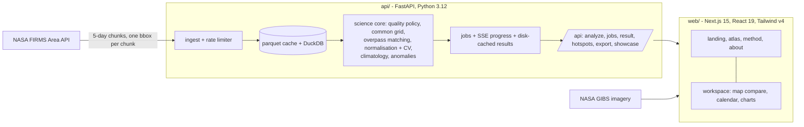

# EMBERLINE

**One consistent record of fire, from two sensors.**

[](https://github.com/Kaushik2210/Ember-Line/actions/workflows/ci.yml)
[](LICENSE)
[](https://emberline-zeta.vercel.app)

EMBERLINE harmonizes NASA's MODIS (1 km) and VIIRS (375 m) active-fire records into one
uncertainty-aware calendar of burning activity, so fire seasons can be compared across sensors and
decades. Built for NASA Space Apps 2026, challenge "Harmonization of MODIS and VIIRS Hot Spots".

What you can do in the workspace:

- pick a region (eight curated stories), draw a box or upload a GeoJSON, and choose a period;
- slide between what MODIS saw and what VIIRS saw on the same day, over NASA GIBS imagery;
- read a daily calendar of burning activity in raw MODIS, raw VIIRS or harmonized (VIIRS-equivalent)
  units, with uncertainty bands;
- see typical fire seasons, unusual periods, how well the two sensors agree before and after
  normalising, and what data each sensor actually contributes;
- export CSV, GeoJSON and a methods card, or share a link that reproduces the exact view.

## Architecture



- **`api/`** is the only place that holds the FIRMS key and the only place numbers are computed.
  The browser never sees the key and never computes a statistic.
- **Data layer** (`api/emberline/data`): FIRMS client with retries and budget awareness, 5-day chunking on
  a fixed grid, parquet cache, DuckDB store, availability and coverage tracking.
- **Science core** (`api/emberline/science`): see [`docs/validation/punjab-haryana.md`](docs/validation/punjab-haryana.md)
  for a full real-data report and the Method page in the app for the equations.
- **`web/`** reads everything from the API; pages that only display findings never trigger a download.

## Quickstart

Needs Python 3.12 with [uv](https://docs.astral.sh/uv/) and Node (developed on 22).

```bash
cp .env.example .env        # then put your FIRMS key in FIRMS_MAP_KEY
cd api && uv sync
uv run pytest               # tests need no key and no network
uv run uvicorn emberline.main:app --reload --port 8000
```

```bash
cd web && npm install && npm run dev      # open http://localhost:3000
```

Run `npm run e2e` in `web/` for the Playwright suite (screenshots at 1440x900 and 390x844, axe audit,
outage states). It starts the servers itself if they are not already running.

## Keys

One key is needed: a free NASA FIRMS MAP_KEY from <https://firms.modaps.eosdis.nasa.gov/api/map_key/>.
It is read by the API server only and is never sent to the browser. NASA GIBS imagery needs no key.
`.env` is git-ignored.

## Data

The atlas and landing page show real numbers only for regions whose NASA data is downloaded.

```bash
cd api
uv run python ../scripts/prefetch.py --dry-run     # how many requests a run needs
uv run python ../scripts/prefetch.py               # all eight regions, resumable, in the background
uv run python ../scripts/prefetch.py --regions punjab-haryana --start 2019-10-01 --end 2019-11-30
uv run python ../scripts/make_synthetic.py         # SYNTHETIC data for dev and tests only
```

FIRMS bills 2 transactions per requested day and allows 5,000 per 10 minutes, so a full six-region,
2000 to 2025 prefetch is about 11,000 requests and takes several hours of budget. The prefetch pauses
when the budget runs low and can be stopped and resumed. Data lives in `data/` (git-ignored). Synthetic
data is always labelled and is never shown as real. FIRMS behaviour measured while building this is
in [`docs/DECISIONS.md`](docs/DECISIONS.md).

## Deploying

- **Web (Vercel).** Project `emberline`, root directory `web`, connected to this repository, so every push
  to `main` deploys. Set `NEXT_PUBLIC_API_URL` to the API's public URL and redeploy; without it the site
  loads and says plainly that the data service is not reachable.
- **API (any Docker host with a disk).** [`render.yaml`](render.yaml) is a Render blueprint: it builds
  `api/Dockerfile`, mounts a disk at `/data`, and expects `FIRMS_MAP_KEY` (secret) and `WEB_ORIGIN` (the
  Vercel URL, comma-separated for several) in the dashboard. The disk needs the downloaded data (`data/`
  from the prefetch, about 0.4 GB for two regions); the API cannot run on Vercel's serverless functions
  because of that data and long-running jobs.

## Limitations

- **Coverage:** harmonization needs at least a year and several VIIRS-era years to fit; the VIIRS 375 m
  record starts in 2012, so earlier values are reconstructed from MODIS with wider uncertainty.
  Before July 2002 only Terra-MODIS exists and a separate Terra-only model is used.
- **Not a burned-area product.** Counts and fire radiative power describe detections, not area burned.
- **FRP homogeneity:** VIIRS FRP processing changed in 2015 and Terra's overpass time drifted; neither
  is corrected, and the Method page says so.
- **Cloud and overpass gaps:** a day with no detections can mean no fire or no observation.
- **Unexplained result:** the Punjab and Haryana 2024-25 season is far below the others. The pipeline
  reports it; the cause is not established here (policy, weather and data effects are all possible).
- **Prototype:** no accounts, no persistence beyond a disk cache, one process.

## Status and docs

All eight phases are implemented; see [`CHANGELOG.md`](CHANGELOG.md).

| Doc | What it is |
|---|---|
| [`docs/PITCH.md`](docs/PITCH.md) | 2-minute demo script, 5-slide outline, challenge-objective mapping |
| [`docs/DEMO.md`](docs/DEMO.md) | 90-second golden path and pre-demo checklist |
| [`docs/DECISIONS.md`](docs/DECISIONS.md) | FIRMS facts, science and design choices |
| [`docs/DESIGN.md`](docs/DESIGN.md) | design tokens |
| [`docs/validation/`](docs/validation/) | real-data validation report |

API docs: run the API and open `/api/docs`.

## Acknowledgment

We acknowledge the use of data and/or imagery from NASA's Fire Information for Resource Management
System (FIRMS) (<https://earthdata.nasa.gov/firms>), part of NASA's Land, Atmosphere Near real-time
Capability for Earth observations (LANCE) (<https://earthdata.nasa.gov/lance>) and NASA's Earth Science
Data and Information System (ESDIS). EMBERLINE is not affiliated with or endorsed by NASA.

## License and team

MIT, see [`LICENSE`](LICENSE). Team names are still to be added. Contributions: [`CONTRIBUTING.md`](CONTRIBUTING.md).
